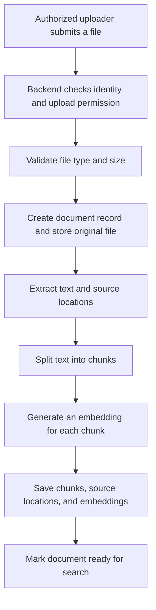
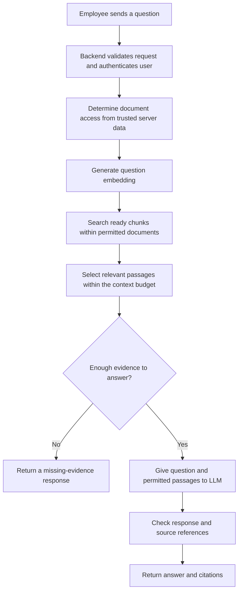

# Axon Chatbot — Architecture Guide

## Purpose and status

This document describes the proposed design, not implemented functionality. We will build and verify it one small piece at a time.

The chatbot helps an employee find answers in documents they are allowed to read. RAG means Retrieval-Augmented Generation: find relevant evidence first, then give that evidence to a language model to help it write an answer.

Running example, using a fictional policy:

> HR Policy, section 4.2: Employees receive 20 working days of annual leave per year. Leave requests require manager approval.

For “How many annual leave days do I get?”, the expected answer is 20 working days with a reference to section 4.2. For “Can unused leave carry over?”, the provided policy does not specify an answer.

## 1. The main components

| Component | Responsibility | Example |
| --- | --- | --- |
| Next.js frontend | Show the chat, accept questions, display answers and source links. Later, provide document administration for authorized users. | An employee types a leave question and opens its citation. |
| NestJS backend | Validate requests, identify users, enforce permissions, prepare documents, search, and call AI services. | Reject a request for an HR-only document from a general employee. |
| PostgreSQL with pgvector | Store document records, permissions, chunks, and embeddings; search permitted chunks by similarity. | Find a section about annual leave for a question about time off. |
| Original file storage | Keep uploaded source files so they can be viewed or processed again. The storage implementation is undecided. | Keep the original policy separately from its extracted passages. |
| Embedding model | Convert text into a numerical vector that lets us compare meaning. | Represent a passage and a question so we can compare their similarity. |
| Language model, or LLM | Write an answer using the retrieved passages. | Turn the annual-leave passage into a concise answer with a citation. |

The embedding model finds similarities; the LLM writes responses. Neither replaces authorization checks.

Start with one backend application whose responsibilities are organized into modules. Separate services, a separate vector database, and a job queue are not required by the current design.

## 2. Flow A: prepare a document for searching

This is called **ingestion**. It happens when a document is added or updated, rather than for every question.

### Follow the policy through the flow

1. An authorized uploader sends the fictional HR policy to the backend. The backend verifies their identity and upload rights, including whether they may assign the requested readership.
2. The backend validates the file. A file is not trusted merely because its name ends in an allowed extension.
3. The backend creates a document record with a status such as `processing`, stores the original file, and records its access rules.
4. Text extraction produces readable text and available source locations, such as section 4.2. The first supported file format is still to be chosen.
5. Chunking splits the text into passages. A short section may fit in one chunk; long sections may need several. Each chunk keeps its document ID and source location.
6. The embedding service converts each chunk into a vector. Think of a vector as a list of numbers representing aspects of the text's meaning, rather than a human-readable summary.
7. The backend saves the chunks and vectors. It marks the document `ready` only after the required processing succeeds.

Only ready, active documents are eligible for search. If extraction or embedding fails, record a failure state and allow a controlled retry. Partially prepared chunks must not become searchable. Retrying must not create duplicate active chunks.

**Why store both text and vectors?** Vectors help find candidate passages; the original chunk text provides evidence for the answer. Source metadata tells us where that evidence came from.

## 3. Flow B: answer an employee's question

### Follow a leave question through the flow

1. The employee asks, “How much time off do I get each year?” The frontend sends the question and authentication information to the backend.
2. The backend validates the question and verifies identity. It uses trusted server-side permission data, not a client-provided role or list of document IDs as proof of access.
3. The backend embeds the question using the same compatible embedding model and settings as the stored chunks.
4. The database search restricts candidates to ready, active documents this employee may read, then ranks their chunks by similarity. Authorization is part of the search restriction, before selecting the final results.
5. The backend selects a small set of useful passages. “Top-K” means keeping at most K of the highest-ranked results. It also limits the amount of text sent to the LLM so the request fits the model's context window.
6. The annual-leave passage supplies evidence. The backend assigns it a source identifier and sends the question and passage to the LLM with instructions to answer from that evidence.
7. The backend checks that returned citation identifiers belong to the supplied sources and maps them to real document locations. It does not accept arbitrary model-invented source links. Whether a passage actually supports a claim also needs evaluation; valid identifiers alone do not prove correctness.
8. The frontend displays the answer and citation. Opening the source goes through another backend authorization check.

For the carryover question, a leave passage may rank highly but still contain no answer. Similarity measures relevance, not proof. If selected evidence cannot support an answer, the system should say that the provided documents do not specify it. The exact evidence-sufficiency approach will be designed and tested during retrieval and generation work.

## 4. Data we need to preserve

These are conceptual records, not a finished database schema.

| Record | Information to keep | Why it matters |
| --- | --- | --- |
| Document | ID, title, original file reference, processing status, version or active state | Identify the source and exclude incomplete or outdated material. |
| Chunk | ID, document reference, text, position, section or page when available | Reconstruct useful evidence and trace citations. |
| Embedding | Chunk reference, vector, model and configuration information | Compare compatible vectors and know when reprocessing is needed. |
| Access rule | Which users or groups may read or manage a document | Enforce access in search, document management, and source viewing. |

The embedding dimensions are the number of values in each vector. We will choose them after choosing the model. Changing the embedding model may require generating stored embeddings again; matching vector length alone does not guarantee compatibility.

## 5. Permission example — proposed, not final

The following is a discussion example. Real roles and permissions remain your architectural decision.

| Identity | Read general HR policy | Read HR-only procedures | Upload documents |
| --- | --- | --- | --- |
| General employee | Yes | No | No |
| HR document administrator | Yes | Yes | Yes, within their authorized scope |

Authentication answers “Who are you?” Authorization answers “May you perform this action on this document?” Being signed in is not sufficient permission to read every document.

Example acceptance check: ask both users a question that only the HR-only procedure answers. The general employee must receive no restricted passage, answer detail, title, or citation. The administrator may receive a supported answer.

## 6. Trust boundaries: where checks belong

- **Browser → backend:** Treat questions, uploads, claimed roles, and document IDs as untrusted input. Validate input and verify identity and permissions on the backend. Hiding a button is not access control.
- **Backend → database and file storage:** Use parameterized queries. Enforce document access on search, source reads, and management actions. Keep credentials out of the browser.
- **Backend → external AI provider:** Keep API keys on the server. Send only the text needed for the operation. Ingestion sends chunk text for embedding; question answering sends question text for embedding and permitted evidence for generation. Real document use requires agreed data-handling requirements and provider terms.
- **Document text → LLM:** A passage may contain “ignore your instructions” or other malicious content. Treat passages as evidence, not authority. Enforce access outside the model, give it no unnecessary tools, and evaluate malicious-document cases.
- **LLM response → user:** Treat generated text as untrusted output. Render it safely, check source references, and verify authorization when a source is opened.

Logs should record operational information such as request IDs, durations, and failure categories without routinely copying document text, sensitive questions, credentials, or full prompts.

## 7. Decisions still open

- AI provider, generation model, and embedding model.
- Authentication mechanism and actual user/group access rules.
- First supported upload format and file size limit.
- Original file storage implementation.
- Chunk size, overlap if needed, and initial top-K value, chosen through experiments.
- Detailed schema, endpoint contracts, and processing/retry implementation.

Start with direct vector search. Hybrid search, reranking, approximate indexes, and background workers are later options only when a measured problem justifies them.

## 8. How to check your understanding

Walk through the leave example and locate where each action happens: split the document, embed a chunk, verify identity, restrict search, generate an answer, and open a citation.

Then consider two failures:

1. The embedding provider fails halfway through ingestion. The document must stay out of search until processing completes successfully.
2. A general employee asks about an HR-only procedure. Its chunks must never enter that employee's LLM context.

You are ready to move on when you can explain those flows and the difference between finding evidence and writing an answer. You do not need to implement this architecture yet.
